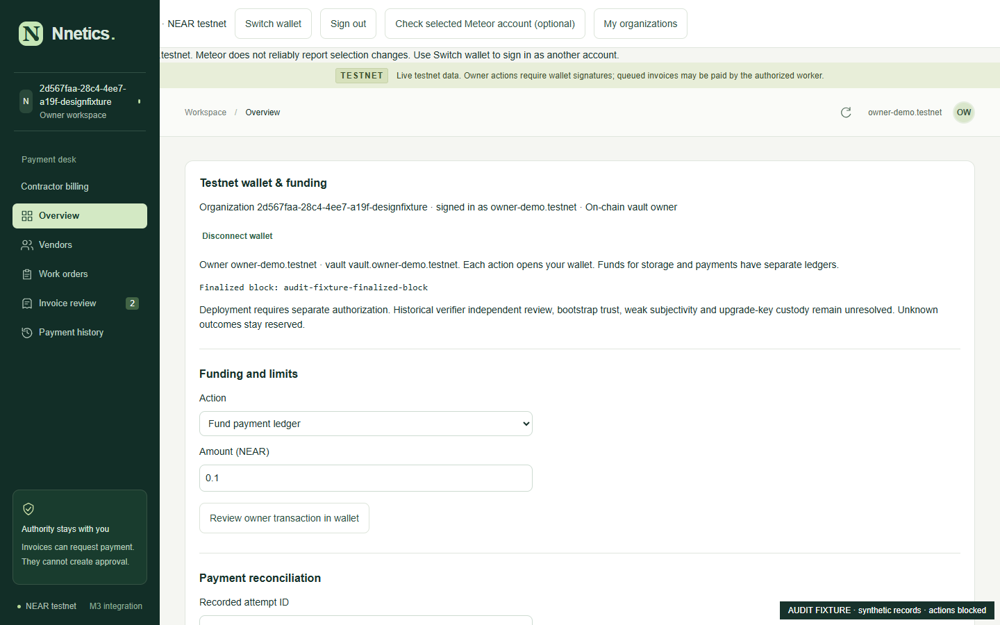
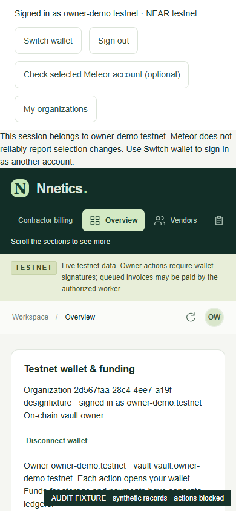
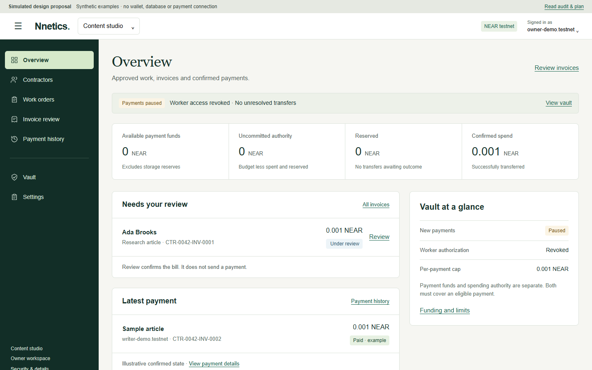
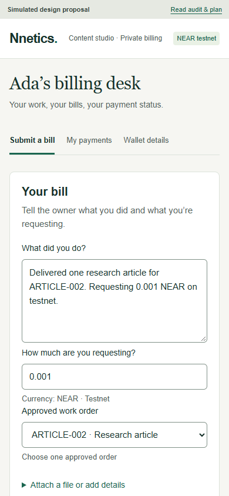

# Nnetics UI/UX review and redesign proposal

**4 November 2026 · Awaiting design approval · No production redesign implemented**

Start with the [interactive proposal](http://127.0.0.1:3210/#overview), then compare the evidence below. Its Preview and State controls sit below each screen. All identities, amounts and records in the proposal are explicitly synthetic. No wallet connector, API client, signing key or database is present; its server rejects mutations and its CSP disables network connections. The real application remains at its existing address.

## Decision proposed

Retain the recognizable green palette and serif page titles. Replace the stacked administrative surfaces with **one compact header, one persistent owner navigation, and contextual page content**. Move funding and limits to Vault; viewer grants to Settings → Access; repair tools to payment details/Diagnostics. Keep contractor profiles and on-chain vendors distinct under one Contractors destination, and distinguish off-chain review from on-chain payment authority throughout.

Do not wrap the current administrative panel in an accordion. Split it by task and retain every authorization boundary. The complete disposition is in [CONTROL_INVENTORY.md](CONTROL_INVENTORY.md); proposed components, migration order and acceptance gates are in [IMPLEMENTATION.md](IMPLEMENTATION.md).

Approval requested: approve this information architecture and visual direction before any changes to production components. Recommended naming is **Contractors**, with **On-chain vendors** as a secondary view; retaining **Vendors** as the top-level label is the one optional naming choice. No additional brand/font decision is necessary: the existing families and palette are retained.

## Scope and evidence

- Repository: `C:/Users/Kazi/Documents/PayScope_Foundation/payscope`, branch `codex/nnetics-live-integration`, starting commit `992ca22717c3f851a6969387f223f07830584c4e`.
- Working tree clean before this task. No applicable `AGENTS.md` found in this repository or its ancestor directories. A sibling worktree's instructions were not applied here.
- Read README, BUILD_BRIEF, current hosting/validation material, route components, styles, adapters, session handling, contractor DTOs and relevant tests. No private database, invitation token or environment credential was copied into this packet.
- The supplied attachment contains the brief only. **No attached screenshots were available**; the current-interface screenshots below were captured for this audit, not attributed to absent attachments.
- Actual running server inspected at `http://localhost:3101` in a new isolated Edge browser context. Actual sign-in/configuration were read; no existing user cookies or wallet sessions were imported. Fresh live wallet signing was neither requested nor performed.
- Authenticated owner/contractor screenshots use the **actual running UI with intercepted synthetic responses**, modeled on the repository's existing browser fixtures. The screenshot watermark makes that limitation explicit. This establishes rendered layout behavior, not live wallet acceptance or current organization contents.
- Current render metrics: [evidence/measurements.json](evidence/measurements.json). Isolated proposal checks: [proposals/verification.json](proposals/verification.json). Execution detail: [VERIFICATION.md](VERIFICATION.md).

## Design direction, using Unslop

1. **Product:** a payment desk where small teams review contractor bills against approved work and trace each payment to its receipt.
2. **Character:** calm, exact, approachable.
3. **World:** a working ledger: warm paper, dark green ink, clearly separated amounts and decisions.
4. **Moments:** the original-text-to-approved-order comparison, and the confirmed receipt. No decorative chart or fabricated trend.
5. **Signature:** show **Work order → Invoice → Confirmed receipt**, with the immutable recipient and provenance at the decision point.

This is an information-architecture correction with targeted visual polish, not a brand replacement. No gradients, neon, emoji-heavy navigation or animated ornament were found in the current product. Preserve what works: visible field labels, status text, exact NEAR amounts, original billing text, immutable-order disclosures, native dialogs, truthful evidence checks and an explicit demo mode. Reduce repeated uppercase meta labels, duplicated warnings, scattered radii/spacing and oversized technical preambles. Findings were checked against Unslop's signs list; absent aesthetic problems are not invented to justify change.

## Prioritized findings

| Priority | Finding and evidence | Cause and proposed response |
|---|---|---|
| P1 | Overview, Vendors, Work orders, Invoice review and Payment history headings start at **y=1,647 px** in a 1440×900 viewport. On 390×844 they start at **y=2,296 px**. The administrative block alone is ~1,369 / 1,672 px tall. | `page.tsx:569` renders `TestnetControls` before `.page-heading` for every live view. Decompose its five sections and queue output; mount only relevant controls on Vault, Access, list import and payment detail surfaces. |
| P1 | The signed-in identity is partially covered on desktop. | `Onboarding` renders `.identity-bar` outside `Dashboard`; `.sidebar` is fixed to viewport top with z-index 20. Only `.workspace-main` receives the sidebar margin. Use one grid shell containing identity, navigation and content. Do not add another compensating margin. |
| P1 | Fresh browser entry presents a generic “session ended / signed out / switched” error even with no prior login. [Actual public sign-in](evidence/actual-public-signin.png). | Initial `/identity` 401 is rendered as an error. Distinguish ordinary anonymous entry from a genuinely expired/revoked session; preserve actual authorization errors. This is a copy/state distinction, not a relaxed login check. |
| P1 | Paused copy says existing attempts still need outcomes even when pending count is zero. [Zero-pending fixture](evidence/state-zero-pending.png). | Two unconditional banners plus technical-panel text. Derive one concise state summary from verified pause/worker/pending state. Only unresolved records justify an unresolved-outcome warning. |
| P1 | A verified vault with budget=0 crashes Overview: **“Division by zero”**. [Reproduced fixture](evidence/state-zero-budget.png). | `page.tsx` divides spent/reserved by `BigInt(v.budget)` in the guardrail bar. Plan a zero denominator presentation guard, not a contract/accounting change. This newly reproduced defect is not covered by the passing existing browser suite. |
| P1 | Off-chain contractor bills and chain invoice eligibility live in separate review interfaces. Contractor billing exits the main owner shell entirely. | `showContractors` returns a different `PortalShell`. Consolidate navigation, preserve separate records/adapters and explicit “billing approval” versus “chain authorization” labels. Never equate approve, link, queue and Paid. |
| P2 | Owner identity and network are repeated across identity bar, notice, sidebar, banner, topbar and administrative block; live organization renders a long UUID instead of the known name. | Pass authorized `Workspace.name` to the shell; show account visibly once, network once, role in context. Keep full identifiers copyable in details. |
| P2 | There is no sidebar toggle. Mobile navigation becomes a horizontal strip where later destinations require horizontal scrolling. | Implement a 240/72 px desktop navigation and a modal drawer at ≤760 px. Remember only the visual preference. Include keyboard focus/close/Escape behavior. |
| P2 | View navigation is React state, not normal URL navigation. Refresh/back cannot reliably return to the selected view. | `View`, `view` and `go()` are local state in `Dashboard`. Add view/record URL state without remounting the authentication provider. URLs never grant org access. |
| P2 | Contractor primary task is diluted by formatting, attachment, AI consent, separate extraction choices and multiple clarification fields. [Current submission](evidence/contractor-submit-desktop.png). | Keep “What did you do?” and “How much are you requesting?” primary. Put optional attachment/claim fields behind local disclosure; use one structured preview. Deterministic parsing remains the MVP; do not add or configure an AI provider. |
| P2 | “Funded payment ledger” can be mistaken for spendable funds; budget and funds compete without an immediately useful explanation. | Contract `funded` is cumulative. Present `funded − spent − reserved` as available payment funds and `budget − spent − reserved` as uncommitted authority. Keep exact definitions in Vault; never present account balance as spendable. |
| P2 | Actions sometimes look available even when deployment/financial policy will reject them; disabled approval explanations are spatially separated from the button. | Retain server/contract rejection. At the action, show the precise gating reason and recovery path. Do not use a disabled “Deployment disabled” button as a global page decoration. |
| P2 | Broad font/reset and global definition-list rules coexist with a separate portal style system and appended responsive fixes. | Styles are present; no missing stylesheet/reset failure was reproduced. `globals.css` includes Tailwind reset, broad `h1`, `dt`, `dd`, `dl > div` rules; portal CSS has later overrides. Consolidate tokens and scope components, then test owner + portal together. |
| P3 | Implementation labels (“M3 integration”, “Owner preview”, “local payment desk” in live loading), technical review paragraphs and repeated disabled-deployment messages occupy routine workflows. | Remove obsolete labels, move diagnostics to accessible details, and show relevant review limitations before affected financial decisions. Do not erase the security limitations themselves. |
| P3 | Oversized secondary cards, long support copy and uneven type scales dilute the invoice/receipt. | Use restrained rows/tables, 4 px spacing increments, 14–16 px body, 12–13 px metadata, 30–36 px page titles. Let the amount and source comparison carry emphasis. |

### Current screenshots

Desktop: administrative wall and covered identity (fixture, current production UI):



Mobile: navigation and identity controls consume the first screen before the administrative wall begins:



Other captures: [full owner page](evidence/owner-overview-desktop-full.png), [Vendors](evidence/vendors-desktop.png), [Payment history](evidence/payment-history-desktop.png), [separate contractor owner screen](evidence/owner-contractor-desktop.png), [contractor bill](evidence/contractor-submit-desktop.png), [contractor payments](evidence/contractor-my-payments-mobile.png), [wallet request](evidence/contractor-wallet-pending.png), [revoked link](evidence/contractor-revoked.png), [empty account](evidence/state-empty.png), [vault onboarding](evidence/state-draft.png), [restoration](evidence/state-restoring.png), [temporary RPC failure](evidence/state-rpc-error.png).

## Proposed page structure

```text
Sign-in ── saved-session restoration / specific recovery
  └─ Authorized organizations ── Create organization (off-chain)
      └─ Owner shell: account menu + organization switcher + NEAR testnet
          Overview
          Contractors
            Profiles / invitations / wallet requests
            On-chain vendors / import reference / manage vendor
          Work orders
            Billing orders / on-chain authority, explicitly distinguished
          Invoice review
            List → original bill / clarification / review / payment linkage
          Payment history
            Job → attempt → confirmed receipt or blocked outcome / recovery
          Vault
            Onboarding when absent; funds / limits / worker / pause when verified
            Contract details / checkpoint / security / diagnostics
          Settings
            Organization details / Access (viewer grants and revocation)

Private contractor portal
  Submit a bill · My payments · Wallet details

Explicit demo mode retains its own synthetic records and simulation tools.
```

A live heading starts immediately below the compact header; only route-relevant blocking information comes before decisions. The shell does not place every warning above every page. Unknown authority hides protected records with a retry surface; it does not fabricate zero balances. The user's current five-hour session policy stays unchanged.

### Desktop and mobile behavior

- Header 64 px desktop; 76 px mobile, able to grow for long/implicit account IDs. Full authenticated account remains readable and copyable; avoid relying on an avatar or shortened name for identity.
- Desktop sidebar 240 px expanded, 72 px collapsed; one grid variable controls both columns. Icons retain accessible names and tooltips on focus/hover. No fixed duplicate margins.
- Mobile drawer ≤760 px: `aria-modal`, focus enters Close, Tab wraps, background inert, Escape/backdrop/Close dismiss, focus returns to trigger; selecting a destination closes it. It is navigation, not an authentication event. Drawer state does not persist; desktop visual preference does.
- Organization switcher uses the authorized saved name. Fallback: `Workspace · <short ID>` with full ID in settings; never infer a business name from an account. Mobile switcher sits at the top of the drawer.
- URL-based view and selected invoice; browser back/forward and direct links restore authorized location after session restoration. No private-link tokens in route/query state or analytics.
- Sidebar preference key contains only `expanded/collapsed`; no wallet, role, session or record data. A storage failure uses expanded navigation.

## Representative proposals

The full-size prototype includes sign-in, empty onboarding, Overview, Contractors, Work orders, Invoice review, Payment history, Vault, Settings and a component sheet. Contractor tabs show composition, status and wallet request views. Use the state picker for loading, temporary failure, empty, pending and illustrative confirmed states. These are selected scenes, not a functioning accounting model.

| Screen | Desktop | Mobile | Interaction to review |
|---|---|---|---|
| Sign-in | [1440 px](proposals/signin-1440.png) | [390 px](proposals/signin-390.png) | Connect → illustrative off-chain message; advanced account entry secondary |
| Overview | [1440 px](proposals/overview-1440.png) | [390 px](proposals/overview-390.png) | Compact status, meaningful first screen, collapse/drawer |
| Invoice | [1440 px](proposals/invoice-1440.png) | [390 px](proposals/invoice-390.png) | Original text + exact order comparison → review / clarification |
| Contractor | [1440 px](proposals/contractor-1440.png) | [390 px](proposals/contractor-390.png) | Text and requested amount → confirmation; recipient supplied from order |
| Navigation | [Collapsed](proposals/sidebar-collapsed.png) | [Drawer](proposals/sidebar-drawer.png) | Keyboard focus, Escape, preference persistence |





## Visual system

| Token | Value / usage |
|---|---|
| Canvas / surface | `#F6F6F2` / `#FFFFFF`; warm neutral, no gradients |
| Navigation / primary action | `#122E27` / `#1B6650`; hover `#154F3E` |
| Selected surface | `#D6E9CA`, text `#193B2D` |
| Primary / secondary / metadata text | `#17322B` / `#52635A` / `#63736B` |
| Divider / control border | `#DCE3DB` / `#809087`; divider does not establish input affordance |
| Warning | `#795719` on `#FBF4E5` |
| Error | `#9B3E35` on `#FCEEEA` |
| Informational | `#315E78` on `#EDF4F8` |
| Type | Existing Arial/Helvetica sans for controls; existing Georgia serif for page headings; monospace only IDs/source; no font download |
| Scale | Desktop h1 36/43.2, mobile 30/36; h2 20/26; h3 16/24; body 15/22.5; controls 14/20; meta 13/19.5; monetary figures 28/34 with tabular numerals |
| Spacing | 4, 8, 12, 16, 20, 24, 32, 40, 48, 64 px; page gutters 32 desktop / 16 mobile |
| Density | Navigation/controls ≥44 px hit area; one-line records 52–64 px where readable; tables wrap details instead of compressing type |
| Shape | Controls 6 px, panels 8 px, dialogs 12 px; status tags 4 px; no pill treatment for everything |
| Focus | 3 px `#1B6650`, offset 3 px; pale green ring on dark nav. Skip link; real buttons/links/labels; disabled reason adjacent |
| Motion | 120 ms color feedback, up to 180 ms opacity/transform for drawer; no autoplay, fake progress, pulse or deliberate delay; reduce motion to none |
| Layout | Fluid content up to 1456 px including gutters; narrow forms 640–720 px; owner tables use available width; `minmax(0,1fr)` / `min-width:0` prevent overflow |

Measured key text contrasts range from **5.01:1 to 12.69:1**; white-on-primary is **6.86:1**. These sampled pairs are not a complete accessibility certification. The [component sheet](http://127.0.0.1:3210/#components) shows action hierarchy, inputs, disabled/feedback states and semantic tags. Do not rely on color alone.

### Financial language and status rules

| UI label | Exact meaning |
|---|---|
| Available payment funds | `funded − spent − reserved` from the same finalized vault snapshot; excludes storage/operating funding |
| Uncommitted authority | `budget − spent − reserved`; permission headroom, not money |
| Reserved | Amount locked by unresolved execution/accounting; never released merely because time passed |
| Confirmed spend | Vault `spent` reconciled with terminal evidence; not approvals or queued amounts |
| Cumulative budget | Lifetime spending ceiling in this MVP; no daily/monthly reset implied |
| Per-payment cap | Maximum for one exact approved work order; cannot authorize partial payments |
| Submitted / Needs clarification / Under review | Off-chain bill workflow, independently visible from payment state |
| Approved | Owner reviewed the bill. No transfer implied |
| Held / Queued / Pending / Failed | Separate job/attempt states. Unknown outcomes stay blocked |
| Paid | Confirmed chain evidence + exact job/order/recipient/amount linkage; retain the actual transaction link |

If no pending outcomes exist: **“Payments paused · Worker access revoked · No unresolved transfers.”** If there are N: **“Payments paused · N transfer(s) awaiting confirmation; funds remain reserved.”** RPC failure: **“Verification temporarily unavailable. Your session is retained; protected records and financial actions wait for verification.”** Never replace an unknown value with zero.

## Official design references consulted

These principles inform this proposal; they do not require adopting another design library or identity.

- **Apple:** prioritize important content near the top/leading edge; make layout adapt; allow sidebars to hide and keep hierarchy shallow. Applied to immediate Overview content, a discoverable toggle and a single navigation level. Native Liquid Glass is not copied into this web app. [Layout](https://developer.apple.com/design/human-interface-guidelines/layout), [Sidebars](https://developer.apple.com/design/human-interface-guidelines/sidebars).
- **Carbon shell:** keep navigation and global utilities in a consistent shared shell. Applied to one owner header/account menu and stable sidebar rather than competing top-level surfaces. [UI shell header](https://www.carbondesignsystem.com/building-blocks/core/components/ui-shell-header/guidelines).
- **Carbon disclosure:** disclosures reveal grouped secondary content. Applied to diagnostics/source history inside relevant pages, never a giant hiding place for the whole administrative wall. [Accordion](https://www.carbondesignsystem.com/building-blocks/core/components/accordion/guidelines).
- **Carbon forms/tables/notifications:** group related controls, make input requirements explicit, keep comparison columns consistent and use feedback at the right scope. Applied to labeled fixed amounts, stable status tables, inline clarification and contextual blocking messages. [Forms](https://www.carbondesignsystem.com/building-blocks/core/patterns/forms), [Data table](https://www.carbondesignsystem.com/building-blocks/core/components/data-table/guidelines), [Notifications](https://www.carbondesignsystem.com/building-blocks/core/components/notification/guidelines).
- **Shopify current app guidance:** separate resource pages, progressively disclose conditional form content, and distinguish system, inline and transient feedback. Applied to Contractor detail, Invoice detail, focused review forms and single-action recovery. No Polaris installation or Shopify branding. [App design](https://shopify.dev/docs/apps/design), [Forms and saving](https://shopify.dev/docs/apps/design/user-experience/forms), [Messages and feedback](https://shopify.dev/docs/apps/design/user-experience/alerts).
- **Shopify empty resources:** explain the absence and provide a relevant primary action. Applied to Create organization / Add contractor / No submitted invoices; no fabricated live chart or balance. The guessed old empty-state URL was unavailable, so current official resource guidance was used. [Resource-list migration guidance](https://shopify.dev/docs/apps/build/app-home/migrate-from-polaris-react/resource-list), [App Home patterns](https://shopify.dev/docs/apps/build/app-home).

## Skills actually used

- [Unslop](C:/Users/Kazi/.agents/skills/unslop/SKILL.md): actual instructions and signs/tokens/direction references read. Audit, five-line direction, retained brand, ordered correction plan and rendered comparison applied. Attribution: **Unslop by Damir Sokolovsky (@heydamir), CC BY 4.0**. The skill's direction-review gate is honored: only requested proposals are authored; production editing waits for the user's design review.
- [Stageshow](C:/Users/Kazi/.agents/skills/stageshow/SKILL.md): actual instructions and craft/framing/looks/kit/rehearsal references read. Copied and rendered `examples/static-card`, then adapted it to a small Nnetics invoice study using the real Stage, Window, Text and Row kit. [Study](http://127.0.0.1:3210/scene.html), [source](stage.tsx), [rehearsal and limitations](REHEARSAL.md). Full page proposals remain accessible, responsive HTML rather than miniature marketing canvases.

## Preserved payment and release boundaries

The existing real `CTR-0001-INV-0002` remains associated with its original text, `ACCEPTANCE-001`, **0.001 NEAR** and **babygoat.testnet**. Existing confirmed transaction: [6nV9YHQ…FzQefR1](https://testnet.nearblocks.io/txns/6nV9YHQxUWLX6yYcPpTEUHyLxoC1K3UEWguSdFzQefR1). No mock is attached to that real identity.

Fresh read-only final-block verification at **00:37 WAT on 4 November 2026**, height **276116702**, confirmed the pinned vault code, Grandtheft owner, no vault keys, paused state, null worker authorization, zero reservation, one attempt and the same Paid amount/recipient. No transaction was signed or sent. Actual server configuration still reports transactions disabled.

This proposal does **not** establish independent security review, mainnet readiness or hosted production readiness. No independent security review has occurred. The earlier hosting rollout remains a separate approval decision; this task neither publishes code nor deploys hosting. No recurring payments, Hermes, AI integration, contract migration or new financial capability is proposed.
